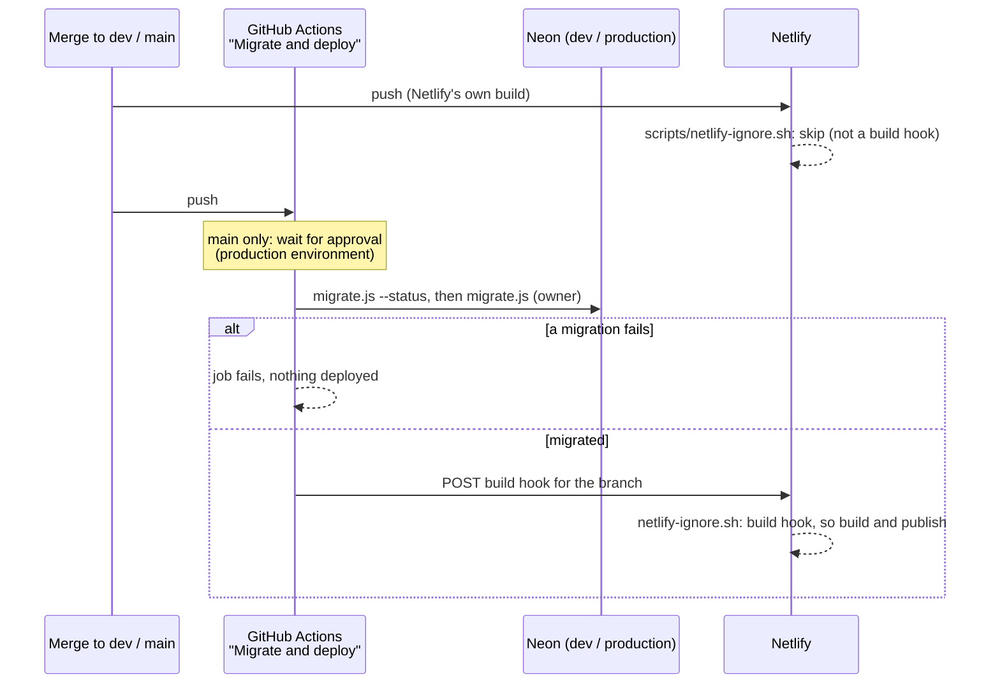

# Deploys and migrations

Since issue #32, a push to `dev` or `main` migrates the database **before** the code
goes live. Nobody runs `npm run migrate` by hand for a normal release.

## Why

Twice the code reached `dev` before Neon `dev` had its migrations (PR #31, then PR #43).
Every admin event page returned a 500 until someone ran the migrations by hand. The
second time, the manual run went to **production**, because `.env.local` points there.
Nothing enforced the order "migrate, then deploy".

## The flow



- **Workflow:** `.github/workflows/deploy.yml`. It runs on a push to `dev` or `main` and
  can also be run by hand ("Run workflow", or `gh workflow run deploy.yml --ref dev`).
  GitHub only offers a manual run once the workflow file is on `main`.
- **GitHub environments:**

  | Environment | Branch | Approval | Neon branch |
  |---|---|---|---|
  | `dev` | `dev` | none | `dev` |
  | `production` | `main` only | required reviewer | `production` |

- **Secrets:** each environment has its own two secrets.
  - `NEON_OWNER_URL`: the direct (unpooled) `neondb_owner` URL for that Neon branch.
  - `NETLIFY_BUILD_HOOK`: the Netlify build hook for that git branch.

  The owner URL lives only here, never in Netlify's environment.
- **Order:** Netlify still sees every push. Its `ignore` command
  (`scripts/netlify-ignore.sh`) skips a `dev` or `main` build unless the build came from a
  build hook (`INCOMING_HOOK_URL` is set). Only the workflow calls the hooks, and only
  after migrating. Deploy previews and other branches build as before.
- **One run at a time:** there is a concurrency group per branch. A newer push waits for
  the running migration and never cancels it.
- **Logs:** `migrate.js` prints file names only. A failure prints the migration file and
  the Postgres error, never the URL.

## Rules for migrations

- **Expand, then contract.** A migration must work with the code that is live when it
  runs: the migration goes first and the code deploys a few minutes later. Add columns
  and tables in one release. Drop or rename them in a later release, once no live code
  uses them (example: #44 drops `social_posts.ready` after the Phase 6 release). Then a
  code rollback never needs a database rollback.
- **A rename is an expand with compatibility pieces.** Example: the glossary rename,
  migration `20261203120000_glossary_rename_expand.sql` (#50). It renames the tables and
  columns and leaves, for the old code: updatable views under the old table names,
  trigger-synced shadow columns under the old column names, and CHECKs that accept both
  the old and the new values. A changed *value* can't be aliased (old code filtering on
  it would silently match nothing), so its backfill ships with the code that reads it. A database test
  (`tests/admin/glossary-rename.test.mjs`) runs the old code's queries against the
  migrated schema. A contract migration removes the pieces after the production release
  (`NEON_PERMISSIONS.md`, "Contract later: the glossary rename").
- **One transaction per file.** `migrate.js` runs each file in its own transaction and
  records it in `schema_migrations`. A failure rolls back that file and stops.
- **New files only.** Never edit a migration that has already run anywhere.

## Still manual

- **Role passwords and logins.** A role made by a migration is `NOLOGIN`
  (NEON_PERMISSIONS.md, "Rotating or creating a role password").
- **One-off data steps:** the imports (Google Form, links, LinkedIn ledger, sign-in photos).
- **Netlify UI deploys.** "Trigger deploy" in Netlify starts a non-hook build of `dev` or
  `main`, and `netlify-ignore.sh` skips it. To redeploy without a new commit, re-run the
  workflow, or POST to the branch's build hook (Netlify > Site configuration > Build
  hooks) if the database needs nothing.

## Setup (done once)

1. GitHub environments `dev` and `production`. `production` needs a required reviewer
   and deployment branches restricted to `main`.
2. Netlify build hooks `github-deploy-dev` (branch `dev`) and `github-deploy-main`
   (branch `main`), each stored as `NETLIFY_BUILD_HOOK` in the matching environment.
3. `NEON_OWNER_URL` in each environment. Get it without echoing it, for example:
   ```
   NEON_API_KEY="$(cat ~/.config/neon/api-key)" neon connection-string dev \
     --project-id young-queen-80162551 --role-name neondb_owner --database-name neondb \
     | gh secret set NEON_OWNER_URL --env dev
   ```
   Use the **unpooled** URL. `neon connection-string` gives the direct endpoint unless
   you pass `--pooled`.

## Fallback: migrate by hand

If GitHub Actions is down, run the migrations by hand: `npm run migrate` from `backend/`
with the owner URL of the right branch. Check `NEON_BRANCH` in the env file first:
`.env.local` points at **production**. Then deploy with the build hook.
